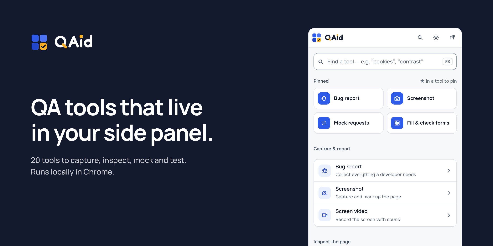
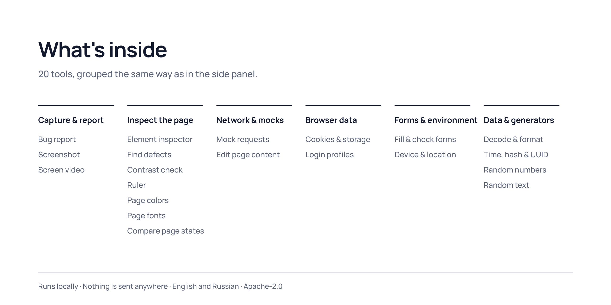
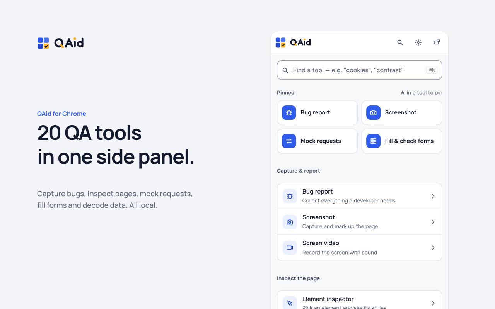
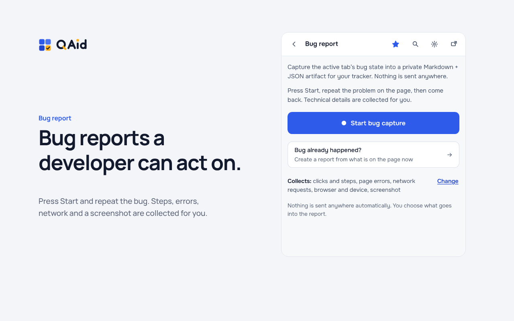
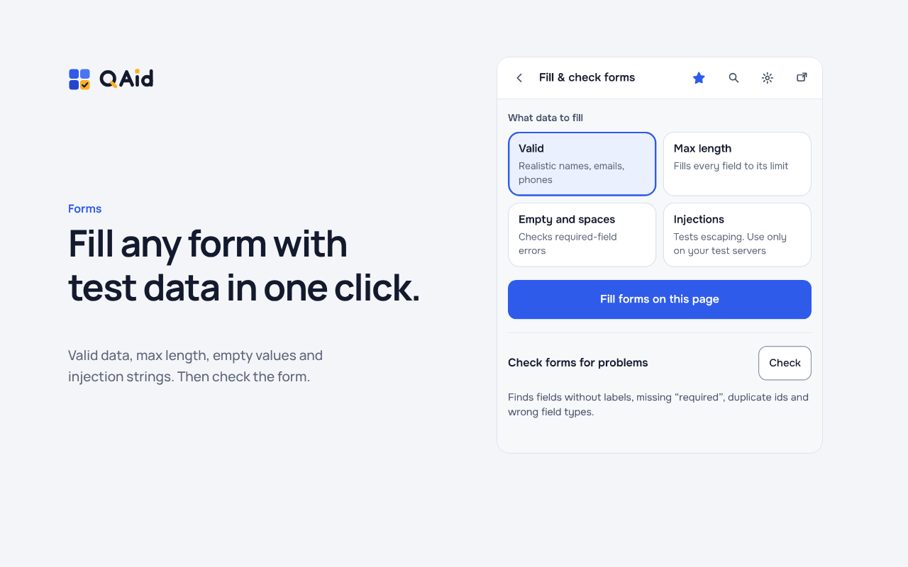
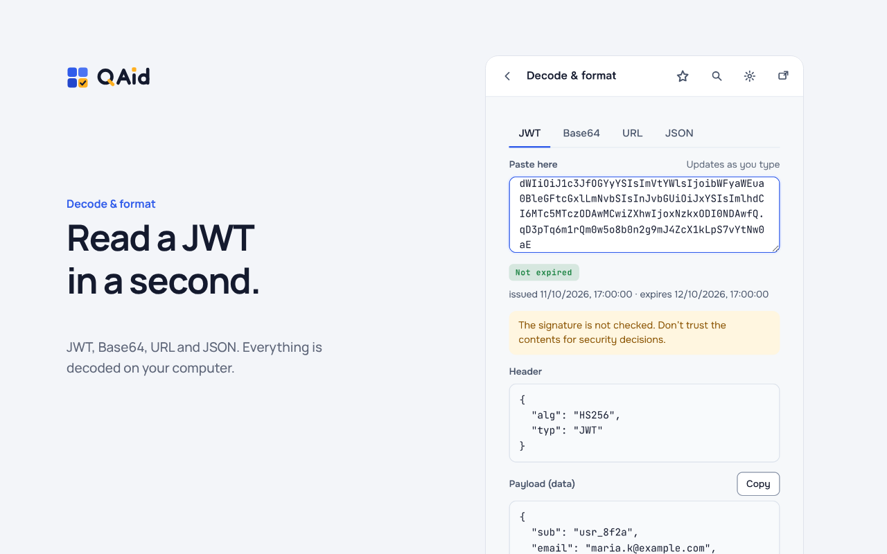
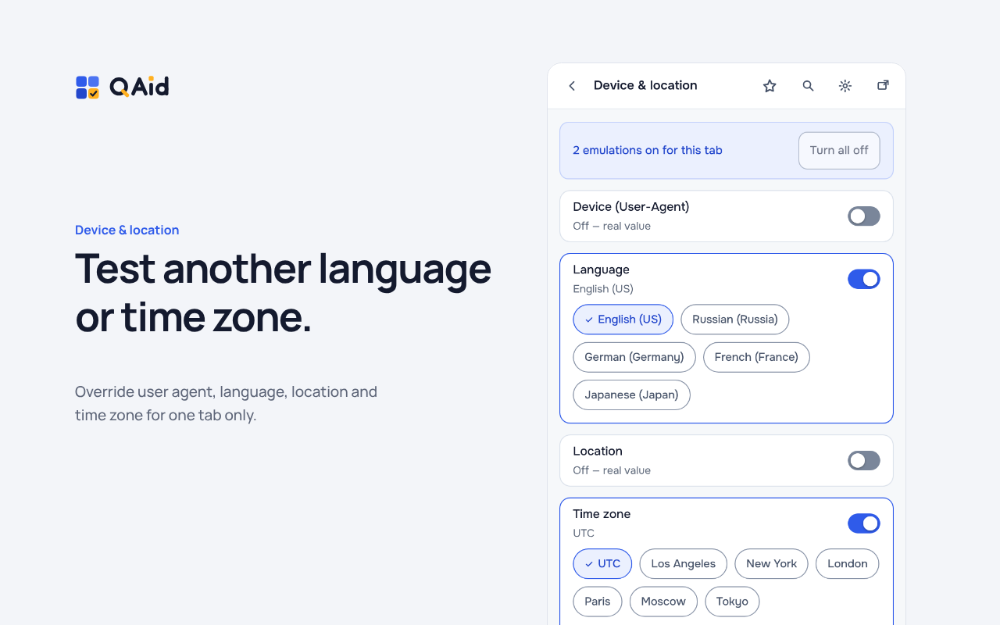

<div align="center">



# QAid — a local-first QA toolbox for Chrome

20 everyday QA and web-debugging tools in one Chrome side panel — bug reports, page inspectors, network mocking, generators and decoders. Free, open source, and runs entirely on your machine.

[](LICENSE)
[](docs/PERMISSIONS.md)
[](docs/DECISIONS.md)

</div>

---

## Why QAid

One side panel instead of a drawer of single-purpose extensions and online JWT/UUID sites. Built for **QA engineers, testers and web developers**.

- **20 tools, one panel** — searchable, pinnable, grouped by task.
- **Local-first** — no account, no telemetry, no network calls from the core.
- **Manifest V3** — least-privilege permissions, requested at runtime.

---

## What's inside



---

## Screenshots

**One side panel, 20 tools** — find any tool with ⌘K, pin your favorites, switch light/dark.



**Bug reports a developer can act on** — reproduce the bug; QAid collects steps, errors, network and a screenshot into a local Markdown + JSON artifact.



**Fill forms with test data in one click** — valid, max-length, empty or injection values, then check the form for problems.



**Decode a JWT in a second** — JWT, Base64, URL and JSON, decoded on your computer.



**Test another language or time zone** — override user agent, language, location and time zone per tab.



---

## Install

Not on the Chrome Web Store yet — load it as an unpacked extension:

```bash
pnpm install
pnpm build
```

1. Open `chrome://extensions` and enable **Developer mode**.
2. Click **Load unpacked** and select the `dist/` folder.
3. Click the QAid icon, then **Open side panel**.

Requires **Node 20 LTS** and **pnpm 9** (`corepack enable`). For development with HMR: `pnpm dev`.

---

## Privacy

QAid's core makes **no network calls and sends no data anywhere**. Bug states, tokens, cookies and page data stay on your computer.

It uses a least-privilege permission model: only essential permissions at install, with host access and scripting requested at runtime under a user gesture. Details in [docs/PERMISSIONS.md](docs/PERMISSIONS.md).

---

## FAQ

**Is QAid free?** Yes — free and open source under [Apache-2.0](LICENSE).

**Does it send my data anywhere?** No. The core runs locally and makes no network requests.

**Which browsers are supported?** Chromium-based browsers with Manifest V3 and the Side Panel API (Google Chrome and compatible builds).

**Do I need an account?** No sign-up, no login, no telemetry.

**Can it replace DevTools?** It complements DevTools — repetitive QA workflows (bug capture, test data, locale emulation, mocking, decoding) in one searchable panel.

**What languages does the UI support?** English and Russian.

---

## Development

<details>
<summary>Scripts</summary>

| Command                             | What it does                               |
| ----------------------------------- | ------------------------------------------ |
| `pnpm dev`                          | Dev build + HMR                            |
| `pnpm build`                        | Type-check + production build into `dist/` |
| `pnpm typecheck`                    | Type checking                              |
| `pnpm lint` / `pnpm lint:fix`       | ESLint (0 warnings)                        |
| `pnpm format` / `pnpm format:check` | Prettier                                   |
| `pnpm test` / `pnpm test:watch`     | Vitest + coverage (≥ 80% on core)          |
| `pnpm test:e2e`                     | Playwright against the built extension     |
| `pnpm package`                      | Build a zip for the Chrome Web Store       |

</details>

<details>
<summary>Project structure</summary>

```
src/
├── platform/     WebExtensions API adapter
├── background/   service worker + message routing
├── content/      content scripts + relay
├── page/         MAIN world script (fetch/XHR interception)
├── popup/        popup UI (Preact)
├── sidepanel/    side panel UI
├── panel/        floating panel body
├── offscreen/    offscreen document (screen recording)
├── features/     self-contained features (logic + ui + descriptor)
├── shared/       messaging, storage, random, serialization…
├── ui/           design tokens and components
└── i18n/         localization catalogs
```

</details>

More: [Architecture](docs/ARCHITECTURE.md) · [Contributing](docs/CONTRIBUTING.md) · [Decisions](docs/DECISIONS.md) · [Permissions](docs/PERMISSIONS.md)

---

## License

[Apache-2.0](LICENSE) — open-core.
